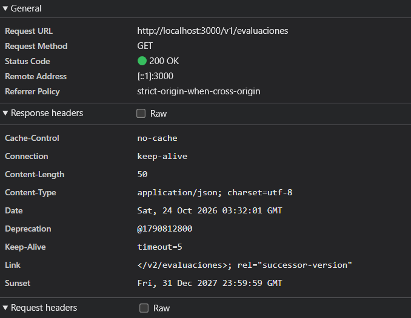

# Entrega · Laboratorio API · Notas del semestre

**Equipo:** ______________________  
**Integrantes:** Juan Esteban Escobar, 
**Repositorio:** https://github.com/Juaneeep/MVC--API

> Completa este archivo a medida que avanzas (cada sección dice en qué parte de la guía se llena).
> Escribe con tus palabras: las respuestas copiadas de la guía o de otro equipo no cuentan.

---

## 1. El contrato que diseñé (Parte 1 · ANTES de programar)

La app de Notas necesita estas seis operaciones. Para cada una decide **el método HTTP, la URI y los estados** que
devolverá (el éxito y los errores posibles). Reglas del juego: la URI nombra un **recurso** (sustantivo, plural,
minúsculas, con versión `/v1`) y el **método** es la acción. No pongas verbos en la URI.

| Operación | Método | URI | Éxito (estado + qué devuelve) | Errores posibles (estado → cuándo) |
|---|---|---|---|---|
| Listar todas las evaluaciones |Listar |GET /v1/evaluaciones |200, arreglo de evaluaciones |Ninguno propio |
| Ver una evaluación |Ver una |GET /v1/evaluaciones/{id} |200, la evaluación |404 no existe |
| Crear una evaluación |Crear |POST /v1/evaluaciones |201, la evaluación nueva y la cabecera Location |400 JSON roto |
| Poner o quitar la nota de una evaluación |Poner o quitar nota |PATCH /v1/evaluaciones/{id} con { "nota": 4.5 } o null |200, la evaluación actualizada | 404 no existe|
| Eliminar una evaluación |Eliminar|DELETE /v1/evaluaciones/{id} |204, sin cuerpo |404 no existe |
| Ver el resumen (acumulado, nota necesaria, estado) |Resumen |GET /v1/resumen |200, acumulado, nota necesaria y estado |Ninguno propio |

### 1b. Critica estas direcciones

Alguien diseñó estas direcciones. Escribe qué está mal en cada una y cómo la reescribirías.

| Diseño original | Qué está mal | Cómo la reescribo |
|---|---|---|
| `POST /crearEvaluacion` |	Lleva un verbo, está en singular y no tiene versión |POST /v1/evaluaciones |
| `GET /getAllEvaluaciones?format=json` |Verbo get repetido, mayúsculas, sin versión y formato en la consulta |GET /v1/evaluaciones |
| `GET /eliminar?id=3` |Verbo en la URI, el id va en la consulta en vez de en la ruta |DELETE /v1/evaluaciones/3 |
| `POST /evaluacion/3/calificar` (responde `200 { "ok": false, "error": "..." }` si la nota es inválida) |Verbo en la URI, singular, sin versión y el fallo se dice en el cuerpo en vez de en el estado |PATCH /v1/evaluaciones/3 |
| `GET /v1/Evaluaciones/` |Mayúscula y barra final |GET /v1/evaluaciones |
| `PUT /evaluaciones` con **toda** la lista de evaluaciones en el cuerpo, cada vez que algo cambia |Se reenvía todo para cambiar un dato y se pueden pisar cambios de otro aparato y no tiene versión | POST para crear, PATCH para cambiar una evaluación y DELETE para borrarla, cada uno sobre /v1/evaluaciones[/{id}]|

## 2. Mis decisiones de estado (Parte 2)

Después de completar `ESTADO_POR_CODIGO`, responde con tus palabras.

| Situación | Estado que elegí | ¿Por qué ese y no otro? |
|---|---|---|
| El peso es 0, o la nota es 7 | 422 Unprocessable Content | El servidor entendió la solicitud (es JSON válido y tiene la forma correcta), pero un valor incumple una regla. No es 400 porque la solicitud no está "rota", y no es 409 porque el error no depende de lo que ya hay guardado: un peso de 0 es inválido siempre. |
| El nombre ya existe, o los pesos pasarían de 100 | 409 Conflict | El valor por sí solo es válido (un peso de 60 está bien, igual que el nombre "Taller"), pero choca con el estado actual del servidor. Si se borra la otra evaluación, la misma solicitud sí funcionaría. Por eso es un conflicto y no un 422. |
| La evaluación no existe | 404 Not Found | El recurso que nombra la URI no existe. Se revisa primero, por eso un PATCH a /v1/evaluaciones/99 da 404 aunque la nota también esté mal: no tiene sentido validar algo que no existe. |
| El cuerpo no es JSON, o está roto | 400 Bad Request | El servidor ni siquiera puede leer lo que se le mandó, así que no llega a revisar las reglas. Es un error de forma, no de contenido. |
| El cuerpo es JSON pero se envió como `text/plain` | 415 Unsupported Media Type | La cabecera Content-Type dice un formato que la API no acepta. El servidor se guía por lo que declara la cabecera, no adivina el contenido. |
| Se pide `PUT /v1/evaluaciones` (no existe ese método ahí) | 405 Method Not Allowed | La dirección sí existe, pero no acepta ese método. Por eso no es 404. La respuesta trae la cabecera `Allow: GET, POST` para decir qué métodos sí se pueden usar. |

1. ¿Por qué calificar usa `PATCH` y no `PUT`? ¿Y por qué crear usa `POST` y no `PUT`?
  Calificar solo cambia una parte de la evaluación, la nota, y PATCH es justamente para cambios parciales. Con PUT habría que mandar la evaluación completa (nombre, peso y nota) para reemplazarla, y se podría      pisar el nombre o el peso sin querer. Crear usa POST porque es el servidor el que decide el id y la dirección del recurso nuevo (la devuelve en Location). PUT se usa cuando el cliente ya conoce la dirección      exacta donde va a quedar el recurso, y aquí el cliente no la conoce.
2. `DELETE` repetido: la primera vez responde 204 y la segunda 404. ¿Eso rompe la idempotencia? Explica qué significa en realidad «idempotente».
  No la rompe. Idempotente significa que repetir la misma solicitud deja el servidor en el mismo estado que hacerla una sola vez, no que la respuesta sea igual. Después del primer DELETE la evaluación ya no existe, y después del segundo sigue sin existir: el estado del servidor es el mismo. El 404 solo informa que ya no había nada que borrar.
3. ¿Por qué el `type` de un problema es un identificador estable y no basta con el `detail`?
   El detail está escrito para personas: puede cambiar de redacción, traducirse a otro idioma o traer datos variables, como "te quedan 40 %". Si un programa decidiera qué hacer comparando ese texto, se rompería    con cualquier cambio de redacción. El type (por ejemplo .../problemas/nombre-duplicado) no cambia nunca, así que un cliente puede reconocer el error con seguridad y reaccionar, por ejemplo marcando en rojo el     campo del nombre.

## 3. MVC a los dos lados del cable (Parte 3)

Dibuja (a mano y pega una foto, o con texto/Mermaid) el recorrido completo desde que el usuario presiona **Agregar**
hasta que ve la fila nueva. Marca en cada paso **el archivo y el método** que actúa, y dónde cruza el cable.

```text
USUARIO escribe nombre, peso y nota, y presiona «Agregar»
   │
   ▼
① cliente/index.html · <form id="form">
   El navegador dispara el evento "submit" del formulario.
   │
   ▼
② cliente/src/vista.js · NotasVista.alAgregar()  (el escuchador de "submit")
   evento.preventDefault()  → la página no se recarga
   Lee el formulario → { nombre, peso, nota } como TEXTO
   Llama al manejador que registró el Controlador.
   │
   ▼
③ cliente/src/controlador.js · NotasControlador.#agregar()
   Convierte el texto: peso → número; nota vacía '' → null (aNota).
   Espera la orden con await #intentar(() => modelo.agregar(datos)).
   │
   ▼
④ cliente/src/modelo-remoto.js · agregar() → #ordenar()
   Una sola solicitud: this.#api.solicitar('POST', '/evaluaciones', { nombre, peso, nota })
   │
   ▼
⑤ cliente/src/cliente-api.js · solicitar()
   Arma la dirección con la versión (/v2) y llama a fetch con el cuerpo en JSON.
   │
   ║
   ║══════════════ EL CABLE: HTTP + JSON ══════════════
   ║   POST /v2/evaluaciones    { "nombre": "...", "peso": 30, "nota": 3.5 }
   ▼
⑥ servidor/nucleo.mjs · crearManejador() → manejar() → resolver()
   Busca la ruta en la tabla (404 si no existe, 405 con Allow si el método no está ahí).
   Para POST llama a leerCuerpoJson(): 415 si no es application/json,
   400 si el JSON está roto o no es un objeto, 413 si es enorme.
   Calcula `base` ("/v2") y llama al manejador con { params, query, cuerpo, base, ... }.
   │
   ▼
⑦ servidor/rutas.mjs · crear()  (el Controlador de la API)
   Toma SOLO nombre, peso y nota del cuerpo (si el cliente manda un id, se ignora)
   y llama a modelo.agregar(...).
   │
   ▼
⑧ servidor/modelo.js · NotasModelo.agregar()
   Valida en orden: nombre (obligatorio, largo, único), peso, nota y suma de pesos.
   │
   ├── ✗ Falla una regla → lanza ErrorDeReglas (con su `codigo`)
   │      │
   │      ▼
   │   servidor/nucleo.mjs · respuestaDeError()
   │      Llama a servidor/rutas.mjs · traducirError(): busca el código en
   │      ESTADO_POR_CODIGO → ErrorHttp con 409 o 422.
   │      Arma el documento con documentoProblema() (RFC 9457) y lo envía con
   │      Content-Type: application/problem+json
   │      { type, title, status, detail: "Ya existe una evaluación con ese nombre.", instance }
   │      ║
   │      ║══════════════ EL CABLE (vuelta con error) ══════════════
   │      ▼
   │   cliente/src/cliente-api.js · lanza ErrorApi (con status y problema)
   │      │
   │      ▼
   │   cliente/src/modelo-remoto.js · traducir()
   │      409, 404 o 422 → ErrorDeReglas con el `detail` del servidor
   │      │
   │      ▼
   │   cliente/src/controlador.js · #intentar() lo atrapa
   │      vista.mostrarError(mensaje) → el mensaje aparece en #error
   │      vista.render()               → el formulario conserva lo escrito
   │      (FIN: no se limpia el formulario)
   │
   └── ✓ Todo bien → push({ id, nombre, peso, nota }) y llama a this.#cambio()
          │
          ▼
⑨ servidor/modelo.js · NotasModelo.#cambio()
   this.#almacen.guardar(this.evaluaciones)  →  servidor/almacen.mjs
   (el servidor es el único dueño de los datos)
          │
          ▼
⑩ servidor/rutas.mjs · crear() devuelve { status: 201, cabeceras: { Location }, cuerpo }
   (el cuerpo sale de servidor/representaciones.mjs · representarEvaluacion)
   servidor/nucleo.mjs · enviar() lo escribe como application/json
          │
          ║
          ║══════════════ EL CABLE (vuelta con éxito) ══════════════
          ║   201 Created   Location: /v2/evaluaciones/4   { "id": 4, ... }
          ▼
⑪ cliente/src/cliente-api.js · solicitar() devuelve el resultado
          │
          ▼
⑫ cliente/src/modelo-remoto.js · #ordenar() → sincronizar()
   «El servidor es la verdad»: pide de nuevo la lista y el resumen
   (GET /v2/evaluaciones y GET /v2/resumen), guarda las copias y avisa a los suscriptores.
          │
          ├─────────────────────────────────────┐
          ▼                                     ▼
⑬ cliente/src/vista.js · NotasVista.render()   ⑭ cliente/src/termometro-vista.js · TermometroVista.render()
   Lee modelo.evaluaciones y                      Lee modelo.resumen().
   modelo.resumen().                              Llena la barra según el acumulado
   Crea cada <tr> con createElement /             y actualiza la leyenda.
   textContent. Actualiza el resumen y #estado.
          │
          ▼
⑮ cliente/src/controlador.js · #intentar()  (la orden salió bien)
   vista.limpiarError()       → borra #error
   vista.limpiarFormulario()  → vacía los tres campos
          │
          ▼
USUARIO ve la fila nueva en la tabla, el resumen actualizado y el termómetro movido
```

1. ¿Qué archivos del navegador **no** tuviste que tocar al conectar la API? ¿Qué te dice eso de la arquitectura?
2. ¿Dónde viven ahora las reglas de negocio? ¿Por qué el navegador no debe validar «por su cuenta» el peso, si ya lo sabe?
3. Cuando el servidor se cae, ¿qué ve el usuario? ¿Qué pieza del MVC lo decide?

## 4. Versionado (Parte 4)

Clasifica cada cambio posible a la API como **compatible** (los clientes existentes siguen funcionando) o **rompe** a
los clientes existentes, y justifica en una frase.

| Cambio | ¿Compatible o rompe? | ¿Por qué? |
|---|---|---|
| Agregar el campo `aporte` a cada evaluación |Compatible |Un campo nuevo se ignora si el cliente no lo conoce. |
| Cambiar `peso` por `porcentaje` en cada evaluación |Rompe |El campo que los clientes leen desaparece. |
| Devolver `nota` como texto (`"4.2"`) en vez de número |Rompe |Cambia el tipo y los cálculos con la nota fallarían. |
| Agregar el endpoint `GET /v1/evaluaciones/{id}/historial` |Compatible |Es un endpoint nuevo que nadie usa aún. |
| Pasar la lista de un arreglo a un objeto `{ datos, paginacion }` |Rompe |Cambia la forma y un .map() sobre el arreglo falla. |
| Exigir un campo nuevo, `profesor`, al crear una evaluación |Rompe |Los POST actuales sin ese campo empezarían a fallar. |
| Cambiar el `porPagina` por defecto de 10 a 20 |Compatible |La forma no cambia, aunque conviene avisar. |
| Aceptar también `peso` con decimales de coma (`"12,5"`) |Compatible |Se acepta más y lo anterior sigue funcionando. |

**Plan de retiro de la v1.** Fechas que usaron en `Deprecation` y `Sunset`: ______________________.
¿Cómo se enteraría un cliente real que nunca lee tu documentación? ¿Qué pondrías en tu plan para ayudarlos a migrar?

## 5. Evidencias (Partes 2 a 5)

**Salida de `npm test`** (pega el final, donde dice cuántas pruebas pasan):

```text
✗ 100 de 110 pruebas pasan.
(Se muestra un grupo a la vez. Con "npm test -- --todo" ves todos los fallo
```

**Captura de pantalla** de la pestaña *Network* del navegador mostrando las cabeceras `Deprecation` y `Sunset` de `GET /v1/evaluaciones`:

**Fragmento de `/openapi.json`** con la operación `GET /v2/evaluaciones`:

```json
/v2/evaluaciones/{id}":{"get":{"operationId":"obtenerEvaluacion_v2","tags":["v2"],"summary":"Obtiene una evaluación","parameters":[{"name":"id","in":"path","required":true,"description":"Identificador de la evaluación.","schema":{"type":"integer","minimum":1}}],"responses":{"200":{"description":"La evaluación.","content":{"application/json":{"schema":{"$ref":"#/components/schemas/Evaluacion"}}}},"404":{"description":"No existe la evaluación.","content":{"application/problem+json":{"schema":{"$ref":"#/components/schemas/Problema"}}}}}},"patch":{"operationId":"calificarEvaluacion_v2","tags":["v2"],"summary":"Pone, cambia o quita la nota de una evaluación","parameters":[{"name":"id","in":"path","required":true,"description":"Identificador de la evaluación.","schema":{"type":"integer","minimum":1}}],"requestBody":{"required":true,"content":{"application/json":{"schema":{"$ref":"#/components/schemas/Calificacion"}}}},"responses":{"200":{"description":"La evaluación con su nota nueva.","content":{"application/json":{"schema":{"$ref":"#/components/schemas/Evaluacion"}}}},"400":{"description":"El cuerpo no es JSON válido, está vacío o no es un objeto.","content":{"application/problem+json":{"schema":{"$ref":"#/components/schemas/Problema"}}}},"404":{"description":"No existe la evaluación.","content":{"application/problem+json":{"schema":{"$ref":"#/components/schemas/Problema"}}}},"415":{"description":"El cuerpo no se envió como application/json.","content":{"application/problem+json":{"schema":{"$ref":"#/components/schemas/Problema"}}}},"422":{"description":"La nota debe ser un número entre 0 y 5, o null.","content":{"application/problem+json":{"schema":{"$ref":"#/components/schemas/Problema"}}}}}}
```

## 6. Reflexión

1. En la clase pasada el Modelo guardaba en `localStorage`. ¿Qué problemas concretos resolvió llevarlo a un servidor? ¿Cuáles problemas **nuevos** aparecieron (piensa en tiempo, fallos, dos aparatos)? Anteriormente los datos no se guardaban, la informacion no permanecia en dos equipos o al limpiar el cache. Ahora los datos persisten. Los nuevos problemas se basan en la velocidad de la red
2. ¿Qué parte de lo que hicieron hoy es **REST de verdad** y qué parte es solo «JSON sobre HTTP»? (Pista: recursos, representaciones, métodos con significado, estados, sin estado.)
Lo que hicimos es REST de verdad en fue las URIs nombran recursos, no acciones, /v1/evaluaciones, en ves de  /listarEvaluaciones; los  métodos tienen semántica real, GET nunca modifica nada y si se llama mil veces el resultado es el mismo, DELETE borra y un segundo DELETE al mismo id da 404 porque el estado del servidor cambió los estados HTTP comunican exactamente
  qué pasó segun el estado. El servidor no guarda
  memoria del cliente entre solicitudes

3. Elijan un principio de diseño de endpoints que les costó respetar. ¿Cuál era la tentación y qué prueba o regla los detuvo?
No poner verbos en la URI. Como usar /calificar o /eliminar. Asi se siente que accion cumple. Lo que nos detuvo fue la parte 1 cuando comparamos nuestras URIs con la tabla de errores  /crearEvaluacion mal, nos quedó que el método ya es el verbo y la URI solo debe nombrar el recurso.
4. La documentación OpenAPI y el código pueden contradecirse. ¿Cómo las pruebas de la Parte 5 lo evitan? ¿Qué otra forma conocen de mantenerlas de acuerdo?
si el código tiene un endpoint que no está documentado, o el doc describe uno que no existe, la prueba falla. Hasta el momento no conocemos otra forma de hacerlo
5. Si esta API la usaran 50 aplicaciones de otras personas, ¿qué cambiaría en su manera de evolucionarla?
Tendríamos que anunciar cualquier cambio con meses de anticipación usando Deprecation y Sunset, mantener las versiones viejas  funcionando más tiempo
ss